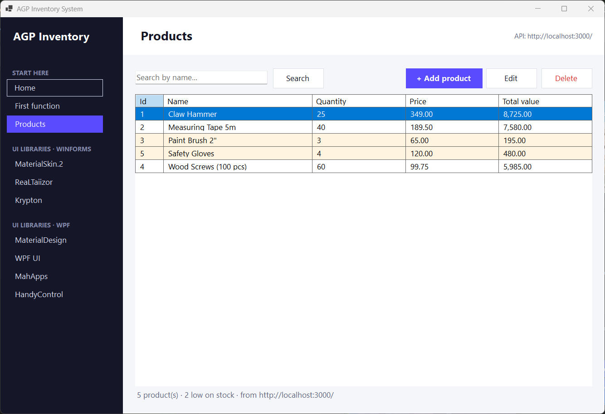

# AGP Inventory System

A beginner-friendly starter template for an inventory management system built in three parts:

| Layer    | Technology                                   | Hosted on |
|----------|----------------------------------------------|-----------|
| Frontend | C# desktop app (.NET 10, WinForms + WPF pages) | Runs on the user's Windows PC |
| Backend  | Node.js + Express (REST API)                 | [Render](https://render.com) |
| Database | PostgreSQL                                   | [Aiven](https://aiven.io) |

The template already works end to end with one feature, **products**:
the app reads, adds, edits and deletes products in PostgreSQL through the API.
Every new feature you build copies that same pattern.



---

## Team

| Member | GitHub | Role |
|--------|--------|------|
| Shaloh (repository owner) | [@Shaloh69](https://github.com/Shaloh69) | Project lead |
| Alexa Jayme | [@algrze43](https://github.com/algrze43) | Collaborator |
| Mitzi Engbino | [@engbinomitzi](https://github.com/engbinomitzi) | Collaborator |
| Elaiza Potot | [@elai0503](https://github.com/elai0503) | Collaborator |

> Fill in each member's role (Database / Backend / Frontend / QA) – see Section 5 of the guide.

## Start here

> **New to the team? Open the start page first:** <https://shaloh69.github.io/AGP-Inventory-System/>
> (source: [docs/index.html](docs/index.html)), then read the
> **[Beginner's Guide (PDF)](docs/Beginners-Guide.pdf)**.

```bash
git clone https://github.com/Shaloh69/AGP-Inventory-System.git
cd AGP-Inventory-System
```

## Run it locally

**How to run these commands**

1. Open a terminal **in the repository folder** (the one that contains `run-dev.bat`):
   - **VS Code:** *File → Open Folder* → pick `AGP-Inventory-System`, then *Terminal → New Terminal*.
   - **File Explorer:** open the folder, click the address bar, type `cmd`, press Enter.
2. Type a command below and press Enter. Start with `.\run-dev.bat check`.

> Type it **with `.\` in front** – VS Code's terminal is PowerShell, which only runs files from the current
> folder when you write `.\`. (In Command Prompt `run-dev.bat check` also works.)
> Double-clicking `run-dev.bat` runs the default (server + app).

```bash
.\run-dev.bat check            # are git, node, npm, dotnet installed? are .env and ca.pem in place?
.\run-dev.bat setup            # first time: npm install + create tables + sample data
.\run-dev.bat                  # start the Express server, then the C# app
.\run-dev.bat server           # only the server   (http://localhost:3000)
.\run-dev.bat client           # only the C# app   (talks to http://localhost:3000/)
.\run-dev.bat client MahApps   # open the app on a specific page
.\run-dev.bat clean            # delete C# build folders (bin/obj) – fixes most strange build errors
```

| Problem | Fix |
|---------|-----|
| `'run-dev.bat' is not recognized` | Type `.\run-dev.bat`, and make sure the terminal is in the repository folder (`cd` into it). |
| `Object reference not set to an instance of an object` while building | `.\run-dev.bat clean`, then `.\run-dev.bat check` – the C# app needs the **.NET 10 SDK**. `run-dev` already cleans and retries once automatically. |
| The app shows an *unexpected error* window | The message says where it happened; the full details are in `%LOCALAPPDATA%\AGP Inventory\error.log` – send that file when asking for help. |

Before `setup`: copy `server/.env.example` to `server/.env`, paste your Aiven `DATABASE_URL`,
and save the Aiven CA certificate as `server/certs/ca.pem` (see [database/README.md](database/README.md)).

## Where to start coding

| I want to… | Open |
|------------|------|
| change how a page looks / add a button | `client/AppClient/Pages/*.cs` (double-click for the designer) |
| add a page to the menu | the `menu` list in `client/AppClient/Forms/MainForm.cs` |
| write a function | `client/AppClient/Helpers/InventoryMath.cs` |
| call the server from C# | `client/AppClient/Services/ApiClient.cs` |
| add an API endpoint | `server/src/routes` → `controllers` → `models` |
| add a table | a new numbered file in `database/migrations/`, then `npm run db:migrate` |
| try a UI library | the UI LIBRARIES pages in the app (`client/AppClient/Pages/Libraries`, `client/AppClient.WpfPages`) |

---

## How the parts talk to each other

```
 ┌────────────────────┐   HTTPS + JSON    ┌─────────────────────┐   SQL over SSL   ┌──────────────────────┐
 │  C# Desktop App    │ ────────────────▶ │  Node.js + Express  │ ───────────────▶ │  PostgreSQL          │
 │  (client/)         │ ◀──────────────── │  (server/) Render   │ ◀─────────────── │  (database/) Aiven   │
 └────────────────────┘                   └─────────────────────┘                  └──────────────────────┘
```

**Rule:** the C# app **never** connects to the database directly. It only calls the API.
The database password lives only on the server (in environment variables).

---

## Folder structure

```
AGP-Inventory-System/
├── README.md                 ← you are here
├── .\run-dev.bat / run-dev.ps1 ← run everything locally
│
├── client/                   ← C# app  (open AppClient.slnx in Visual Studio)
│   ├── AppClient/
│   │   ├── Program.cs
│   │   ├── Forms/MainForm.cs ← main window: sidebar menu + page area
│   │   ├── Pages/            ← Home, First function, Products, Add/Edit product
│   │   │   └── Libraries/    ← MaterialSkin.2, ReaLTaiizor, Krypton demo pages
│   │   ├── Models/           ← Product.cs (matches the API's JSON)
│   │   ├── Services/         ← ApiClient.cs: all HTTP calls to the server
│   │   └── Helpers/          ← AppConfig, InventoryMath, Navigator, Theme
│   ├── AppClient.WpfPages/   ← MaterialDesign, WPF UI, MahApps, HandyControl demo pages
│   └── capture-pages.ps1     ← re-takes the screenshots in docs/
│
├── server/                   ← Node.js + Express API (deployed to Render)
│   ├── .env.example          ← copy to .env and fill in your own values
│   ├── certs/                ← Aiven ca.pem goes here (never committed)
│   └── src/
│       ├── index.js · app.js
│       ├── config/db.js      ← PostgreSQL connection
│       ├── routes/ controllers/ models/   ← products feature
│       ├── middleware/       ← error handler, 404
│       ├── utils/            ← validateProduct
│       └── scripts/          ← migrate.js, seed.js
│
├── database/
│   ├── migrations/           ← 001_create_products_table.sql …
│   ├── seeds/                ← sample products
│   └── diagrams/             ← ERD images
│
└── docs/
    ├── index.html            ← "Hey, you start here" page (GitHub Pages)
    ├── Beginners-Guide.pdf   ← the full step-by-step guide
    ├── UI-LIBRARIES.md       ← UI libraries usable in C#
    └── screenshots/          ← app/, hello-world/ (library pages), online-templates/
```

---

## Team workflow (Git)

```bash
git checkout main && git pull           # 1. get everyone's latest work
git checkout -b feature/suppliers       # 2. make a branch for your task
git add .                               # 3. stage your changes (check git status: no .env!)
git commit -m "Add suppliers page"      # 4. commit with a clear message
git push -u origin feature/suppliers    # 5. push, then open a Pull Request on GitHub
```

Never commit `.env`, `ca.pem`, passwords, `bin/`, `obj/` or `node_modules/`.
