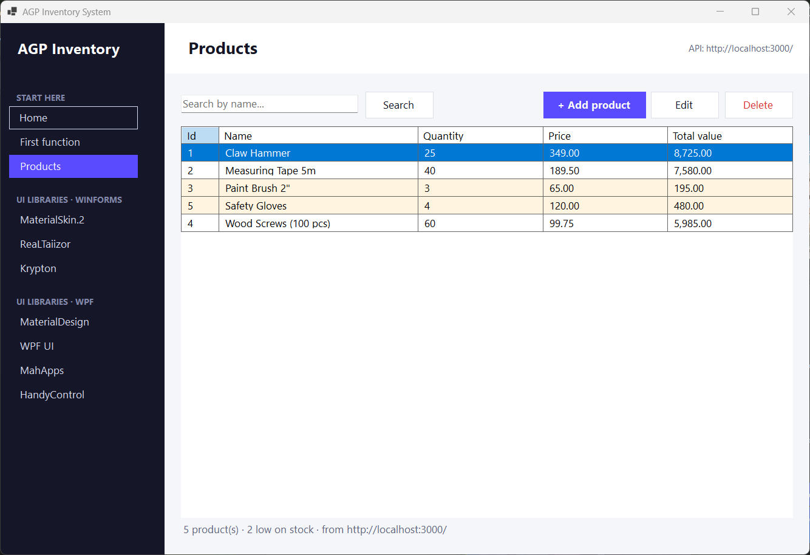

# Client – C# Desktop App (.NET 10, WinForms + WPF pages)

The app the user sees. **This is your starting template:** a main window with a sidebar, where
every menu item is a page. It already reads and stores products through the API, and it has one
page per UI library so you can compare them and copy what you like.



## Run it

```bash
# from the repository root
.\run-dev.bat                    # starts the server, then this app
.\run-dev.bat client             # only the app (pointed at http://localhost:3000/)
.\run-dev.bat client Products    # open straight on a page
```

Or open `client/AppClient.slnx` in Visual Studio and press **F5**
(without `API_BASE_URL` set, the app uses the Render URL in `Helpers/AppConfig.cs`).

## Projects

| Project | What it is |
|---------|-----------|
| `AppClient` | The WinForms app: main window, pages, models, API client |
| `AppClient.WpfPages` | WPF pages for the WPF UI libraries, shown inside the app with `ElementHost` |

## Folder map (`AppClient/`)

| Folder / file | What goes inside |
|---------------|------------------|
| `Program.cs` | Starts the app (`--page Name` opens a page directly) |
| `Forms/MainForm.cs` | The shell: sidebar menu + content area. **The `menu` list is where you add pages.** |
| `Pages/` | One `UserControl` per page: `HomePage`, `FirstFunctionPage`, `ProductsPage`, `ProductFormPage` |
| `Pages/Libraries/` | Demo pages for MaterialSkin.2, ReaLTaiizor, Krypton, and `WpfHostPage` for the WPF ones |
| `Models/Product.cs` | C# class that matches the JSON from `/api/products` |
| `Services/ApiClient.cs` | **The only place that calls the server** (GET / POST / PUT / DELETE) |
| `Helpers/AppConfig.cs` | Server address (`API_BASE_URL` or the Render URL) |
| `Helpers/InventoryMath.cs` | Your first functions (`CalculateTotal`, `IsLowStock`) |
| `Helpers/Navigator.cs` | `Navigator.Go(new SomePage(), "Title")` opens a page from anywhere |
| `Helpers/Theme.cs` | Shared colours, fonts and button styles |

## The pages

| Menu | Shows you how to… |
|------|-------------------|
| Home | check the server + database connection, open another page from a button |
| First function | write a function and call it from a button |
| Products | read from the database, search, open a page and pass data to it, delete |
| (Add / Edit product) | store data: POST a new product or PUT changes, show server errors |
| MaterialSkin.2 · ReaLTaiizor · Krypton | WinForms UI libraries |
| MaterialDesign · WPF UI · MahApps · HandyControl | WPF UI libraries (each loads its theme for its own page only) |

Each library page has a **TRY THIS** list of exercises at the top of its code.

## Add a page in 3 steps

1. **Solution Explorer** → right-click `Pages` → **Add → User Control (Windows Forms)** → `SuppliersPage`.
2. Design it with the Toolbox (drag a `DataGridView`, `Button`s …) and double-click a button to add its code.
3. Add one line to the `menu` list in `Forms/MainForm.cs`:
   ```csharp
   new("Suppliers", () => new SuppliersPage()),
   ```

To open it from code (e.g. a button on another page): `Navigator.Go(new SuppliersPage(), "Suppliers");`
To pass data, give the page a constructor parameter, like `new ProductFormPage(product)`.

## Naming conventions

- Classes, methods, properties: `PascalCase` (`LoadProductsAsync`)
- Local variables, parameters: `camelCase` (`productName`)
- Controls: prefix by type – `btnSave`, `txtName`, `lblStatus`, `dgvProducts`, `numQuantity`
- Async methods end with `Async`; event handlers may be `async void`, everything else returns `Task`

## Re-take the screenshots

```powershell
powershell -ExecutionPolicy Bypass -File client\capture-pages.ps1      # server must be running
```
