# UI Libraries for the C# Frontend

All of these install through **NuGet** (*Project → Manage NuGet Packages*, or `dotnet add package <name>`).
Licences change over time – always confirm on the library's own site before you submit or sell your project.

## Which one should we pick?

| If your team… | Use |
|---------------|-----|
| is brand new to C# and wants drag-and-drop design | **WinForms + MaterialSkin.2** or **WinForms + ReaLTaiizor** |
| wants a modern, Windows 11 look and is OK learning XAML | **WPF + WPF UI** or **WPF + MaterialDesignInXamlToolkit** |
| must also run on macOS / Linux | **Avalonia UI** |

Pick **one** UI framework (WinForms *or* WPF) and **one** main theme library. Mixing several
theme libraries causes styling conflicts.

---

## Windows Forms (WinForms)

| Library | NuGet package | Licence / cost | Why use it |
|---------|---------------|----------------|-----------|
| **MaterialSkin.2** | `MaterialSkin.2` | MIT – free | Google Material look, simple to apply to an existing form |
| **ReaLTaiizor** | `ReaLTaiizor` | MIT – free | Huge set of themed controls (buttons, cards, side menus) |
| **Krypton Toolkit** | `Krypton.Toolkit` | BSD-3 – free | Professional Office-style controls, ribbons, docking |
| **Guna UI 2** | `Guna.UI2.WinForms` | Commercial (trial available) | Very popular modern rounded controls, gradients, shadows |
| **Siticone UI** | `Siticone.Desktop.UI` | Commercial (trial available) | Similar to Guna, modern controls |
| **Bunifu UI** | `Bunifu.UI.WinForms` | Commercial | Animated, flat controls |
| **Syncfusion WinForms** | `Syncfusion.*.WinForms` | Free *Community Licence* (eligible individuals / small teams) | Data grids, charts, schedulers |
| **DevExpress / Telerik** | (installer) | Commercial (trial / student programmes) | Enterprise-grade suites |

## WPF

| Library | NuGet package | Licence / cost | Why use it |
|---------|---------------|----------------|-----------|
| **WPF UI** (lepoco) | `WPF-UI` | MIT – free | Fluent / Windows 11 style, navigation views, snackbars |
| **MaterialDesignInXamlToolkit** | `MaterialDesignThemes` | MIT – free | Most popular Material Design library for WPF |
| **MahApps.Metro** | `MahApps.Metro` | MIT – free | Metro/modern window chrome, flyouts, dialogs |
| **HandyControl** | `HandyControl` | MIT – free | 80+ extra controls, many themes |
| **ModernWpf** | `ModernWpfUI` | MIT – free | Windows 10/11 Fluent styles (less active now) |
| **Syncfusion / DevExpress / Telerik WPF** | – | Community licence / commercial | Advanced grids, charts, reports |

## Cross-platform C# UI frameworks

| Framework | Licence | Notes |
|-----------|---------|-------|
| **Avalonia UI** | MIT – free | WPF-like XAML that runs on Windows, macOS, Linux. Pair with `Material.Avalonia` or `FluentAvalonia`. |
| **.NET MAUI** | MIT – free | Windows, Android, iOS, macOS from one project |
| **Uno Platform** | Apache 2.0 – free | WinUI-style XAML on many platforms |
| **Blazor** (web) | MIT – free | C# in the browser. UI libraries: **MudBlazor**, **Radzen Blazor**, **Fluent UI Blazor** |

## Helper libraries (work with WinForms *and* WPF)

| Library | NuGet package | Licence | Use it for |
|---------|---------------|---------|-----------|
| **FontAwesome.Sharp** | `FontAwesome.Sharp` | MIT | Icons on buttons and menus |
| **LiveCharts2** | `LiveChartsCore.SkiaSharpView.WinForms` / `.WPF` | MIT | Animated charts and dashboards |
| **ScottPlot** | `ScottPlot.WinForms` / `ScottPlot.WPF` | MIT | Fast scientific/data plots |
| **CommunityToolkit.Mvvm** | `CommunityToolkit.Mvvm` | MIT | MVVM pattern helpers (WPF / Avalonia / MAUI) |
| **QuestPDF** | `QuestPDF` | Community licence (free for small revenue) | Generate printable PDF reports from C# |
| **ClosedXML** | `ClosedXML` | MIT | Export data to Excel |

## Screenshots

**Left:** the library's page in our app (menu → UI LIBRARIES; code in
[`client/AppClient/Pages/Libraries`](../client/AppClient/Pages/Libraries) and [`client/AppClient.WpfPages`](../client/AppClient.WpfPages)).
**Right:** a template from the library's own GitHub page or website.

| Library | Page in our app | Template online |
|---------|-----------------|-----------------|
| MaterialSkin.2 | 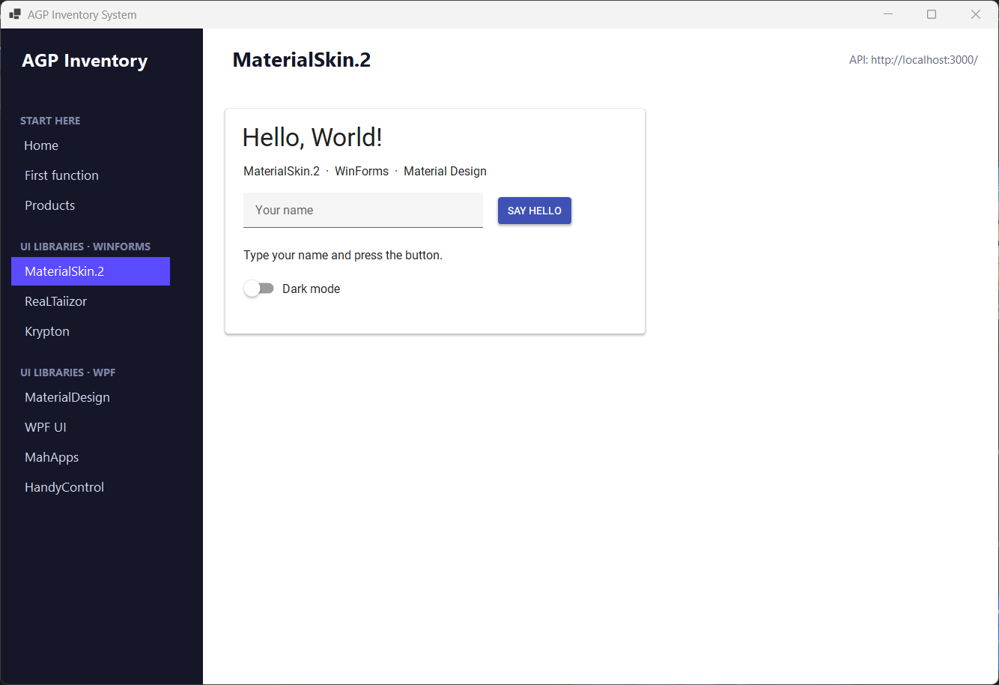 | 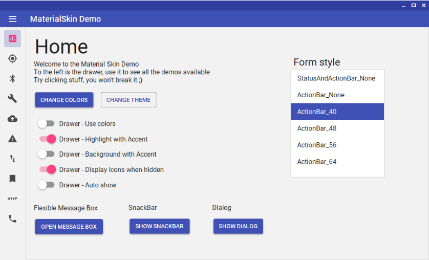 |
| ReaLTaiizor | 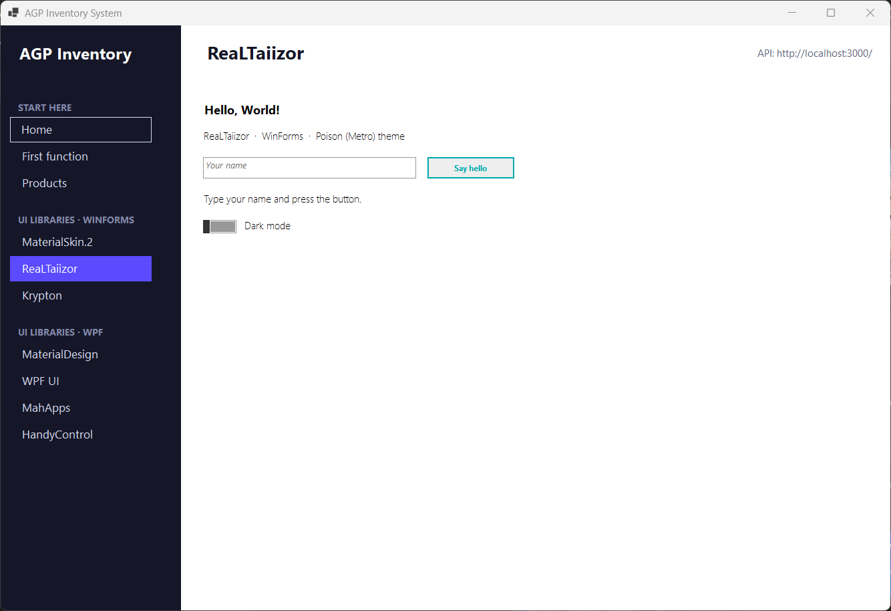 |  |
| Krypton Toolkit | 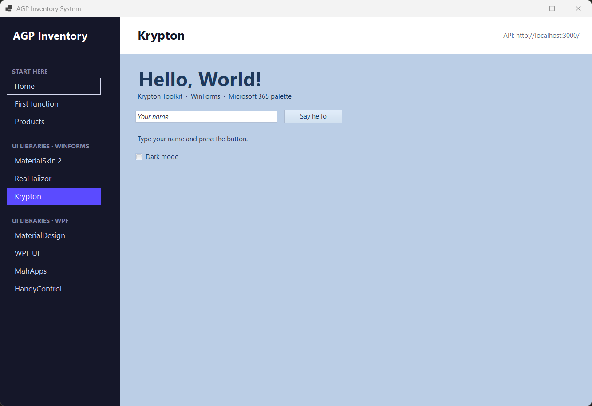 | 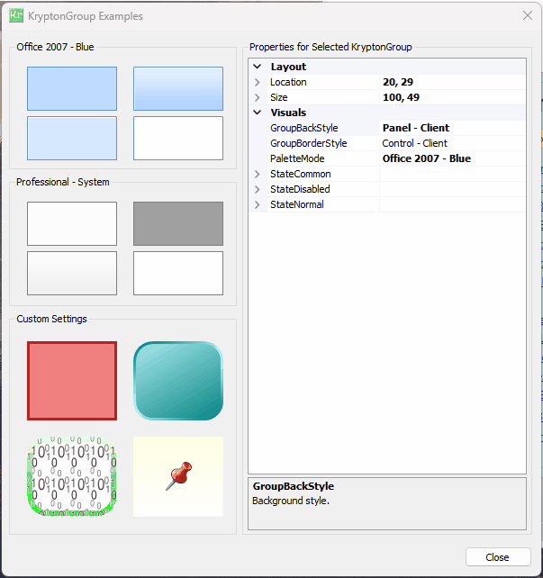 |
| MaterialDesignInXaml | 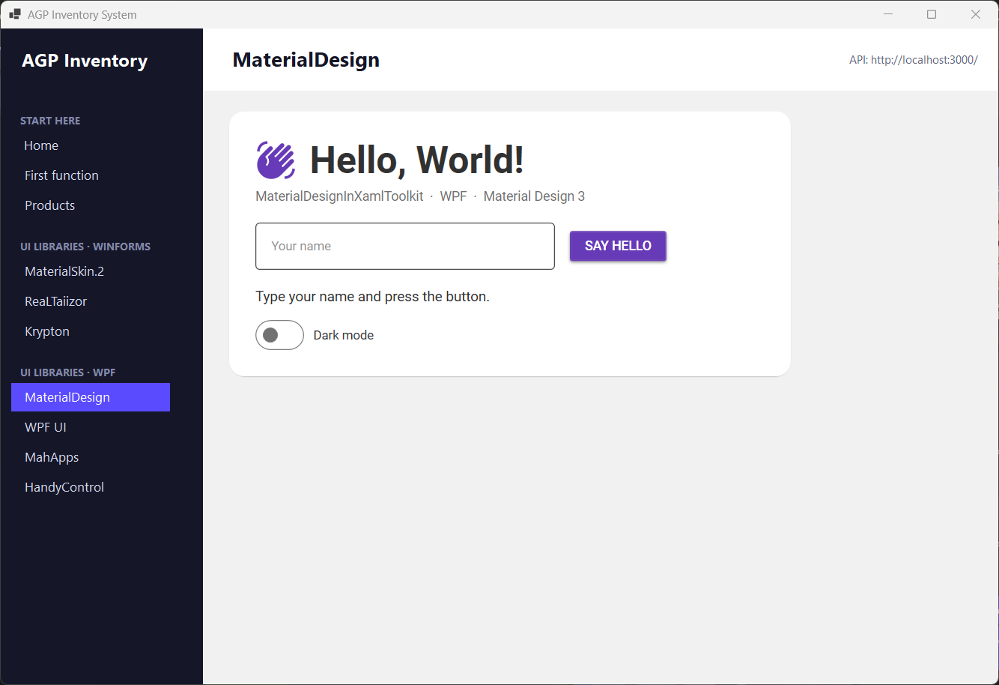 | 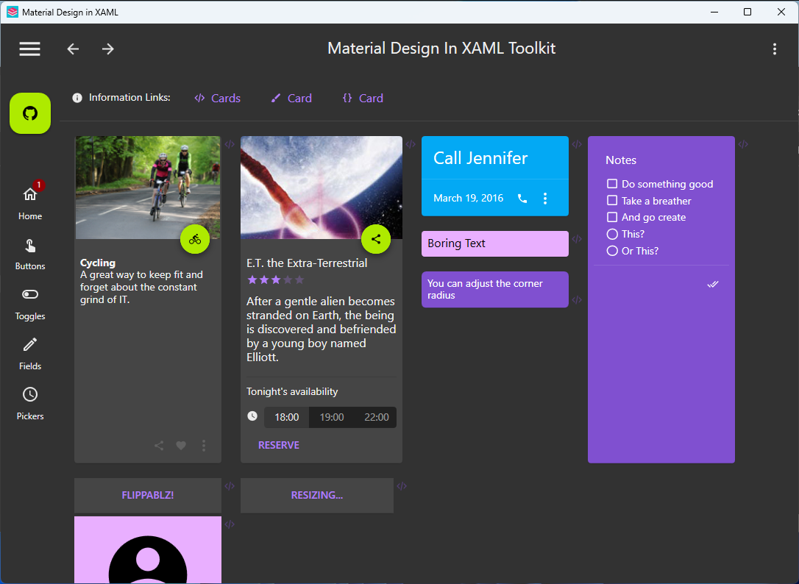 |
| WPF UI | 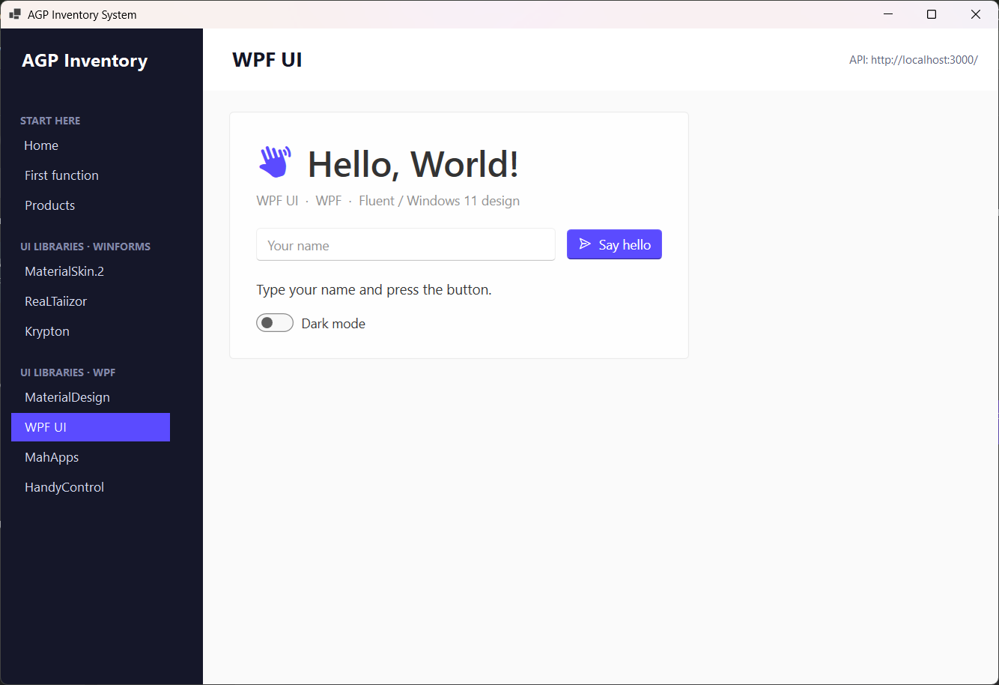 | 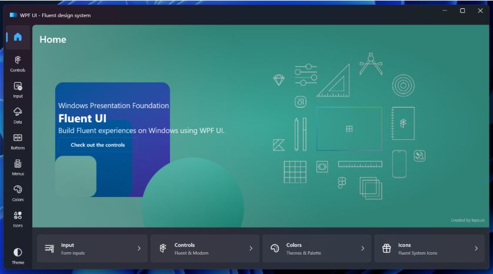 |
| MahApps.Metro | 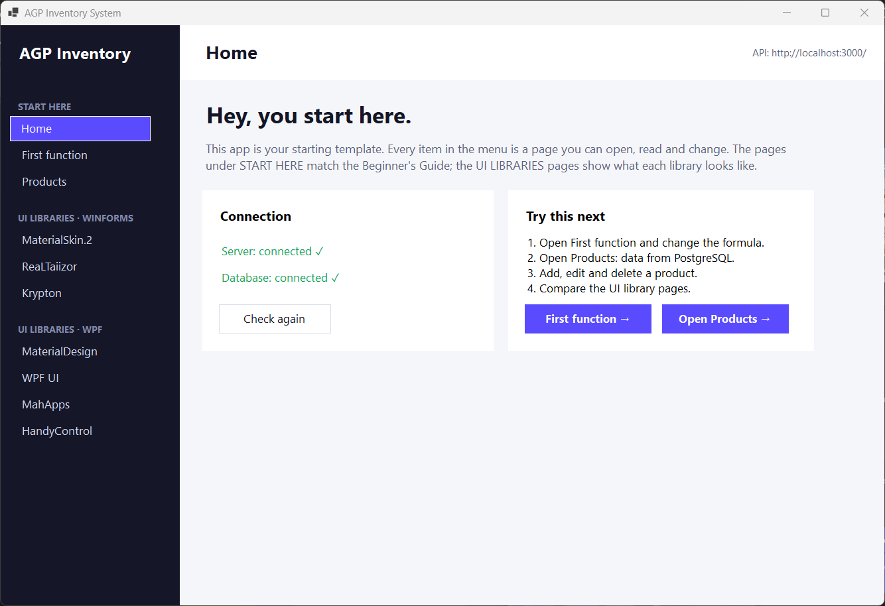 | 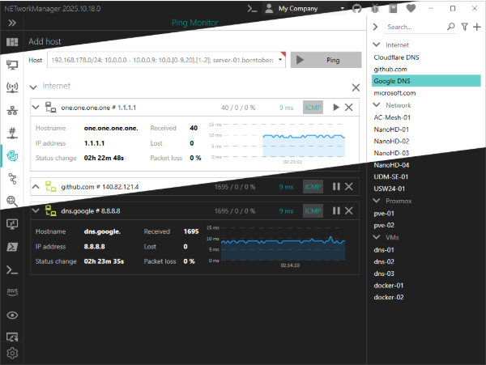 |
| HandyControl | 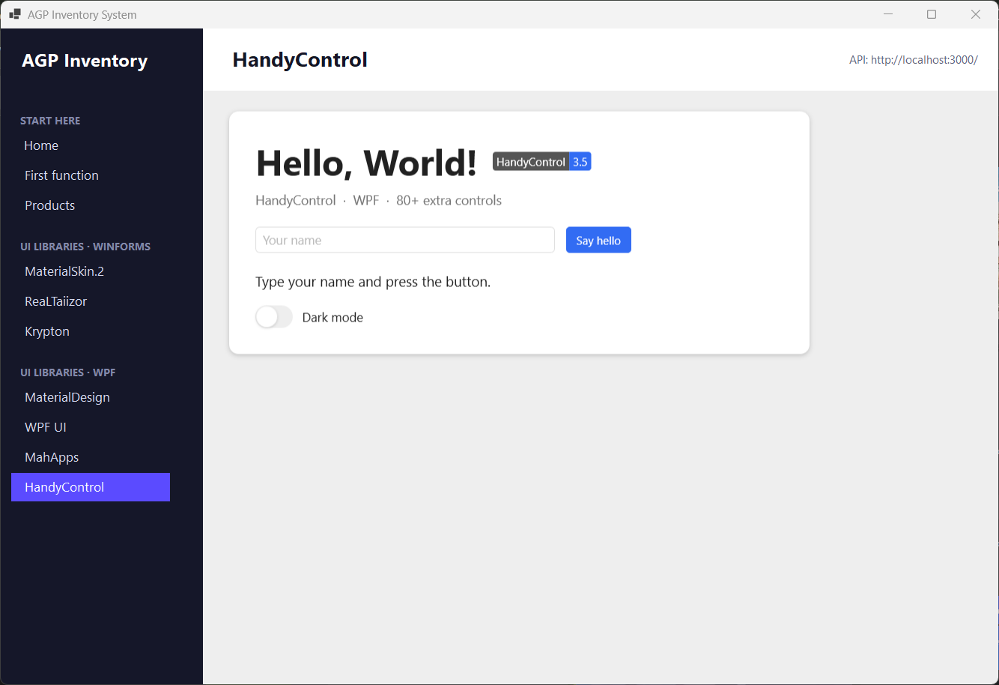 |  |
| Avalonia UI | – | 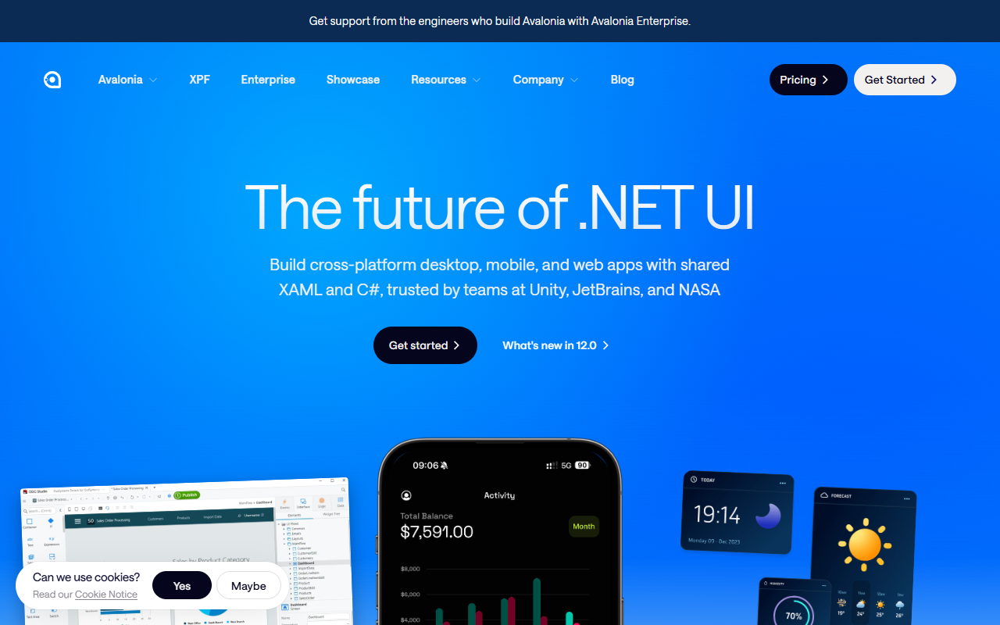 |
| MudBlazor | – | 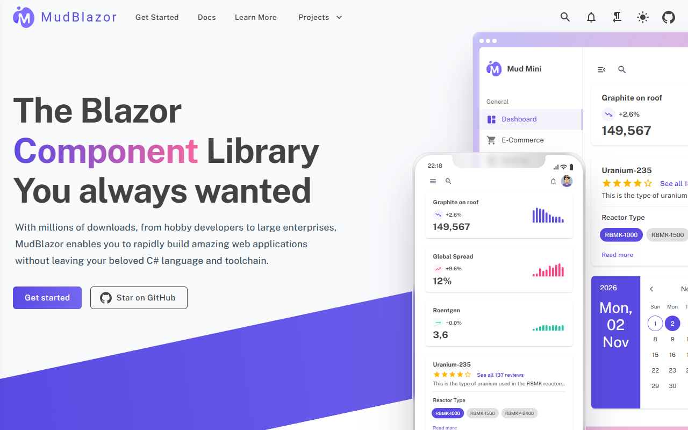 |

> Note: the old `materialdesigninxaml.net` domain currently redirects to an unrelated site.
> Use the GitHub repository (github.com/MaterialDesignInXAML/MaterialDesignInXamlToolkit) instead.

## Recommended beginner starter kits

**WinForms kit**
```bash
dotnet add package MaterialSkin.2
dotnet add package FontAwesome.Sharp
dotnet add package LiveChartsCore.SkiaSharpView.WinForms   # only if you need charts
```

**WPF kit**
```bash
dotnet add package MaterialDesignThemes      # or: WPF-UI
dotnet add package CommunityToolkit.Mvvm
dotnet add package FontAwesome.Sharp
```
